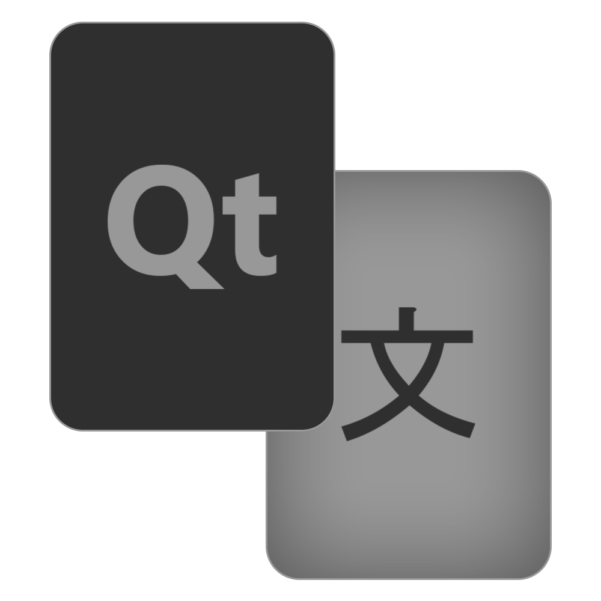
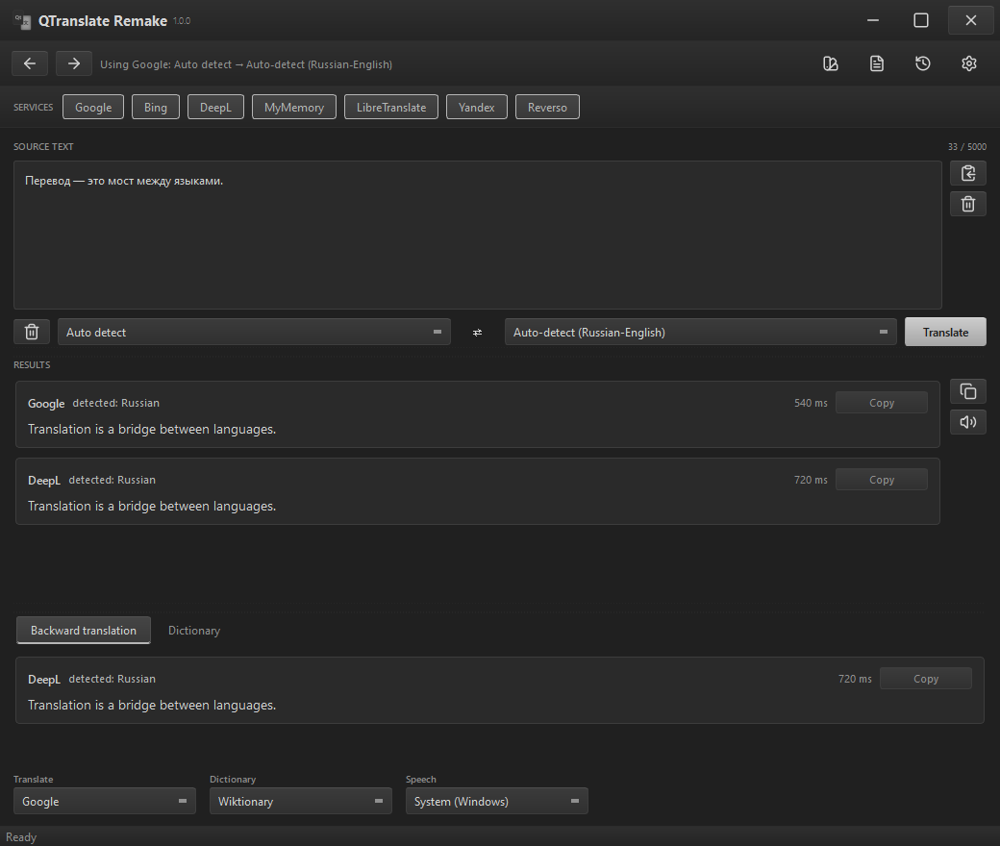
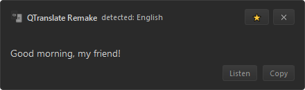
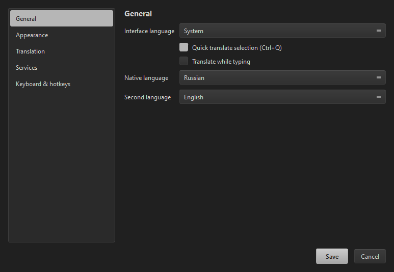
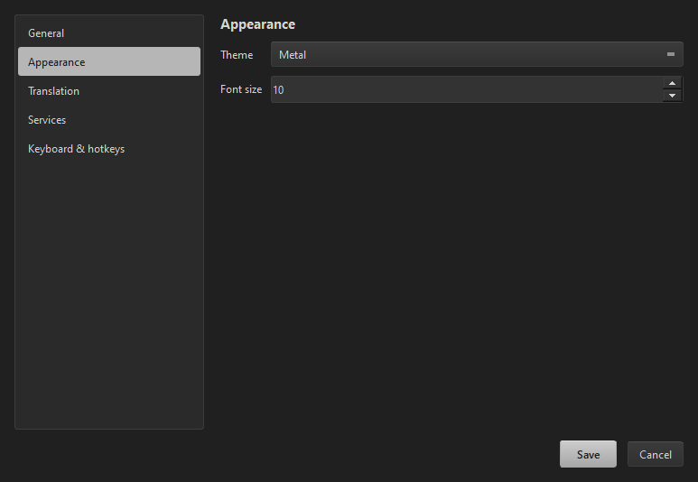
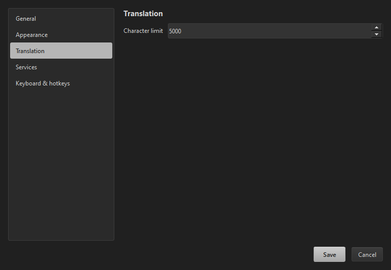
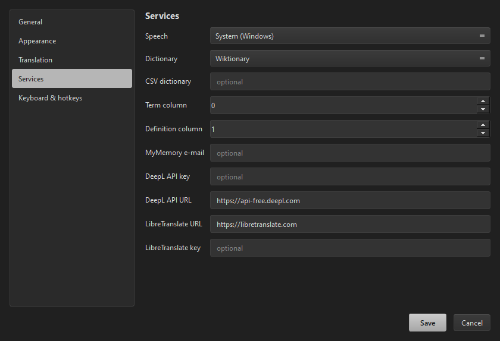
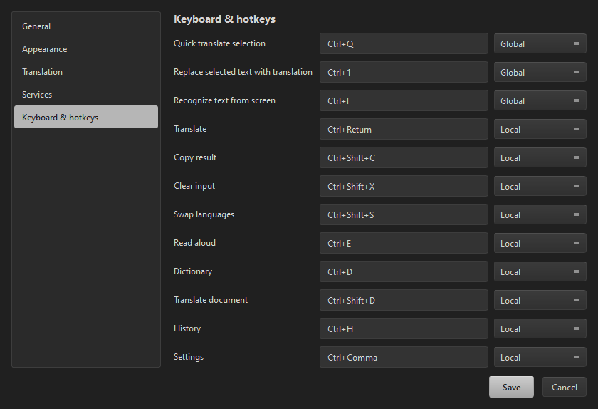
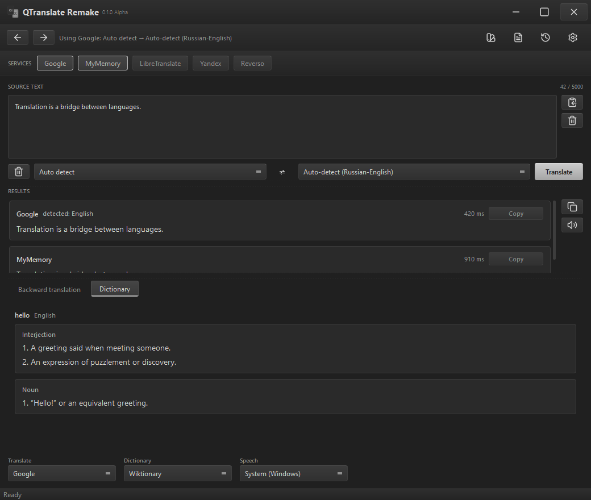

<div align="center">



# QTranslate Remake

**A translator in the spirit of QTranslate 6.10 — but in Python, with its own interface.**

Select text → press `Ctrl+Q` → understand it without switching windows.

[Русский](README.md) · **English**

**Ecosystem:** [QMessages](https://github.com/Awaynos/QMessages) — quick message snippets.


<br>


<br><sub>Main window: several translators at once, the “Russian–English” auto pair, and the backward-translation panel.</sub>

</div>

---

## How it came about

In **February 2026** I wrote the skeleton of my own application — **QTranslate Remake**, an analogue of QTranslate 6.10.0, but in Python. I did not want “yet another translator”; I wanted a tool I understand from top to bottom.

**Eight months later** I decided to come back and finish the project: I got interested in working for the benefit of ordinary users. I used AI to build a proper interface — and the idea of publishing it on GitHub appeared. That is how a personal hobby turned into the project you are reading about now.

There are **no AI features inside**: no summarisation, no rewriting, no calls to language models. Only regular translators, a dictionary, speech, and document handling — by design.

---

## What it can do

### Translation

| | |
|---|---|
| **Several translators at once** | Google, Bing, DeepL, Yandex, Reverso, MyMemory, LibreTranslate — each result in its own card |
| **Automatic language detection** | If a service cannot detect the language itself, it receives the one found by another service |
| **“Native–Second” auto pair** | Type in Russian — get English; type in English — get Russian. No switching |
| **Translate as you type** | With a configurable delay |
| **Backward translation** | A separate tab showing how the result translates back |
| **History** | Back/forward navigation in the header and a dialog with restore |
| **Long text** | Split into parts automatically, with a character limit |

### Quick actions (global hotkeys)

| | |
|---|---|
| **`Ctrl+Q`** | Quick translate of the selection — a popup next to the cursor that closes on an outside click |
| **`Ctrl+1`** | **Replace the selected text with its translation** — right in the app you are working in |
| **`Ctrl+I`** | **Recognise text from the screen**: select an area — the text goes into the input field and is translated |
| **`Ctrl+E`** | Read the selection or the result aloud |
| **`Ctrl+D`** | Dictionary for a word |
| **`Ctrl+Shift+D`** | Translate a document |
| **Every shortcut is configurable** | Record a combination and choose its scope: local or global |

### Services

| | |
|---|---|
| **Speech** | System engine (Windows SAPI) and Google TTS |
| **Dictionary** | Wiktionary (official MediaWiki API) and **your own CSV dictionary** — a glossary, abbreviations, error codes |
| **No API keys** | Google, Bing, DeepL (free web endpoint), Yandex, Reverso and MyMemory work without a key. DeepL can use its official API with a key, LibreTranslate can point at your own server |

### Documents

Translate **TXT, SRT, VTT, DOCX, PDF** with progress and cancellation.
Subtitles keep their timings, DOCX keeps paragraphs and tables, PDF is returned as text.

### Interface

- A custom window without the system frame: drag by the title bar, resize from any edge, `– □ ✕` buttons inside the app.
- **Four themes:** Metal, Turquoise, Bronze, Light. Default — Metal, font size 10.
- **A loading indicator with the logo** — a ring at the cursor and a bar in the status bar.
- **Tray**: minimising sends the window to the tray, a double click brings it back.
- **Screen text recognition** — `Ctrl+I`: select an area, the built-in Windows OCR returns the text, and it is translated right away.
- **Spell checking** — wavy underlines and suggestions on right click; dictionaries come from Windows.
- **Localisation**: Russian, English, German, French, Chinese, Japanese, Kazakh, Georgian, Belarusian and Polish; the interface language is chosen in settings.

### What is remembered

Everything you change is saved and survives a restart: theme, font, languages, enabled services, the chosen “Translate / Dictionary / Speech” services, hotkeys, panel sizes, the selected tab, window size and position.

**Where the data lives:** `%APPDATA%\QTranslate Remake\`
- `settings.json` — all settings;
- `history.json` — translation history.

To open the folder: press `Win+R`, paste `%APPDATA%\QTranslate Remake` and hit Enter. Deleting that folder resets the app to its defaults and clears the history.

<div align="center">

<br><sub>Quick translate on <kbd>Ctrl+Q</kbd></sub>
</div>

---

## Installation and running

You need **Python 3.11+**.

```powershell
git clone https://github.com/Awaynos/QTranslate-R.git
cd QTranslate-R

python -m venv _local\.venv
& "_local\.venv\Scripts\python.exe" -m pip install -r requirements.txt
& "_local\.venv\Scripts\python.exe" run.py
```

A ready build is available: download `QTranslateRemake.exe` from the releases page — no Python needed.

When run from source, settings and history live in `_local\data`; the built `.exe` keeps them in the
user profile — `%APPDATA%\QTranslate Remake`.

---

## Default hotkeys

| Keys | Action |
|---|---|
| `Ctrl+Q` | Quick translate of the selection |
| `Ctrl+1` | Replace the selected text with its translation |
| `Ctrl+I` | Recognise text from the screen |
| `Ctrl+E` | Read aloud |
| `Ctrl+D` | Dictionary |
| `Ctrl+Enter` | Translate |
| `Ctrl+Shift+C` | Copy the result |
| `Ctrl+Shift+X` | Clear the input |
| `Ctrl+Shift+S` | Swap languages |
| `Ctrl+Shift+D` | Translate a document |
| `Ctrl+H` | History |
| `Ctrl+Comma` | Settings |

All of them can be changed in **Settings → Keyboard & hotkeys**.

---

## Settings

Settings is a separate window with a side menu:

- **General** — interface language, native and second language, quick translate of the selection, translate as you type, spell checking
- **Appearance** — theme, font size
- **Translation** — character limit
- **Services** — speech, dictionary, CSV file, MyMemory e-mail, DeepL URL and key, LibreTranslate URL and key
- **Keyboard & hotkeys** — recording combinations and their scope: local or global

<div align="center">
<table>
<tr>
<td align="center"><br><sub>General</sub></td>
<td align="center"><br><sub>Appearance</sub></td>
</tr>
<tr>
<td align="center"><br><sub>Translation</sub></td>
<td align="center"><br><sub>Services</sub></td>
</tr>
<tr>
<td align="center"><br><sub>Keyboard &amp; hotkeys</sub></td>
<td></td>
</tr>
</table>
</div>

---

## Dictionary

<div align="center">

<br><sub>Dictionary: Wiktionary or your own CSV file</sub>
</div>

For your own dictionary, point to a `.csv` file and set the column numbers for the term and its meaning. The encoding is detected automatically (UTF-8 or CP1251), and nothing leaves your machine.

---

## Project structure

```
qtranslate_r/
  domain/       models: languages, translation request/result, errors
  services/     service interfaces, registry, translators, speech, dictionary
  core/         translation orchestration, history, documents, service setup
  config/       settings and data paths
  platform/     Windows integrations: global hotkeys, selection capture, OCR, spell checking
  localization/ interface strings (ru/en/de/fr/zh/ja/kk/ka/be/pl)
  ui/           PySide6: window, dialogs, themes, icons, indicators
  quick.py      quick translate on Ctrl+Q
  inline.py     replace the selection on Ctrl+1
languages/      interface language files
icons/          logo and SVG icon sets
tools/          checks and screenshot rendering
VERSION         application version (edit with Notepad)
run.py          entry point
```

---

## Technologies

| | |
|---|---|
| Language | Python 3.11 |
| Interface | PySide6 / Qt 6 (Essentials package: QtCore, QtGui, QtWidgets, QtSvg) |
| Network | requests |
| Documents | python-docx (DOCX), pypdf (PDF) |
| OCR | Windows.Media.Ocr — the system engine, no external services |
| Spell checking | Windows Spell Checking API |
| Platform | Windows (global hotkeys, tray, window resizing via Win32) |

Services are described by contracts (`Translator`, `TextToSpeech`, `Dictionary`), so a new translator is added as a separate module without touching the core.

---

## What is next

- [x] Screen text recognition (OCR) — `Ctrl+I`
- [x] Spell checking in the input field
- [ ] Image search by word
- [ ] Plugin groundwork: loading services from external modules
- [ ] More translation languages
- [ ] More interface languages
- [ ] Custom themes: create and edit them inside the app
- [ ] Linux and macOS support

---

## ❤️ Support the project

Building and maintaining the translator takes time — I would be grateful for your support 🫡

**Important:** send the transfer **only on the network listed** — a transfer on another network may be lost for good.

| Coin | Network | Address |
|---|---|---|
| **Bitcoin (BTC)** | Bitcoin (SegWit) | `bc1qfaylkgnwct052snamqmnxl3uk26xpt5jg344fs` |
| **Ethereum (ETH)** | ERC-20 | `0x44628629c1C6f8E8591d4f93735Ff6CD70DC8AfC` |
| **Tether (USDT)** | BEP-20 (BSC) | `0x44628629c1C6f8E8591d4f93735Ff6CD70DC8AfC` |
| **Solana (SOL / SPL)** | Solana | `3sTNRxJqATsJsKWyM5dxi4HHMLEKbp8f8dGU4wJ1xmE9` |

Support is entirely optional. You can also help without money: report a bug, suggest an idea, translate the interface, or just star the project.

---

## Version and license

**1.0.0** — the first stable release.
The version lives in the [`VERSION`](VERSION) file and is edited with Notepad.

The project is distributed under the **[PolyForm Noncommercial 1.0.0](LICENSE)** license ([Russian translation](LICENSE.ru.md)) — it is *source-available*, not open source.

The license was chosen deliberately: **it forbids making money from this project**. It matters to me that anyone can freely fork, study and improve QTranslate Remake — but that nobody turns it into a paid product or profits from it.

**You may:** use, study, modify and fork it — for any non-commercial purpose, for free.
**You may not:** sell it, include it in paid products or services, or use it commercially.

Commercial use is possible **only with a separate permission from the author** — write to me if you need it.
