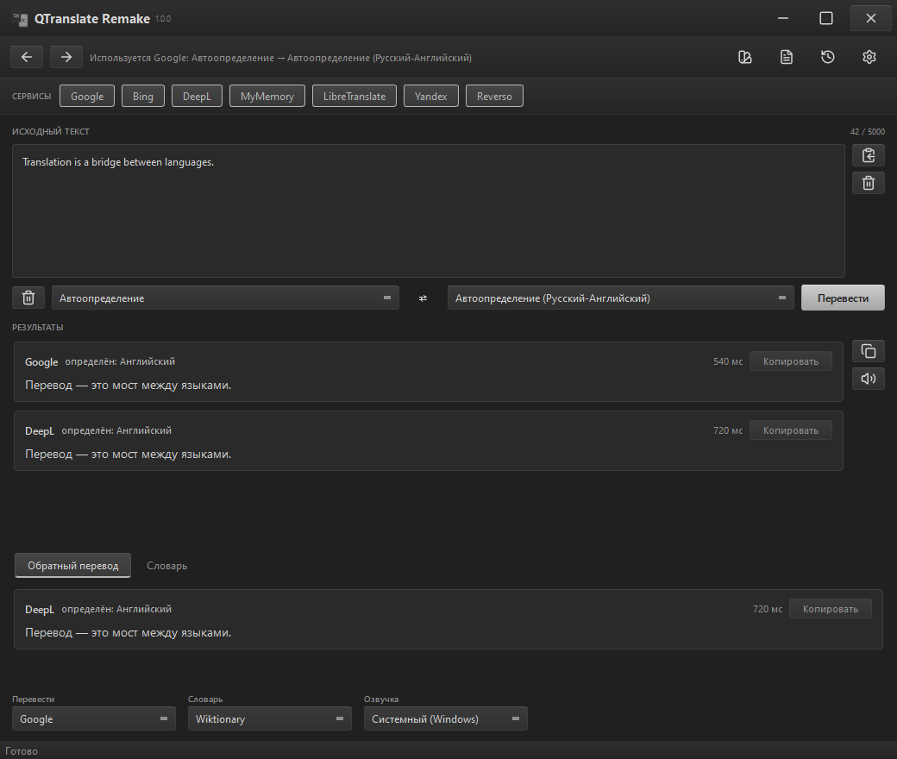
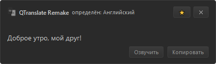
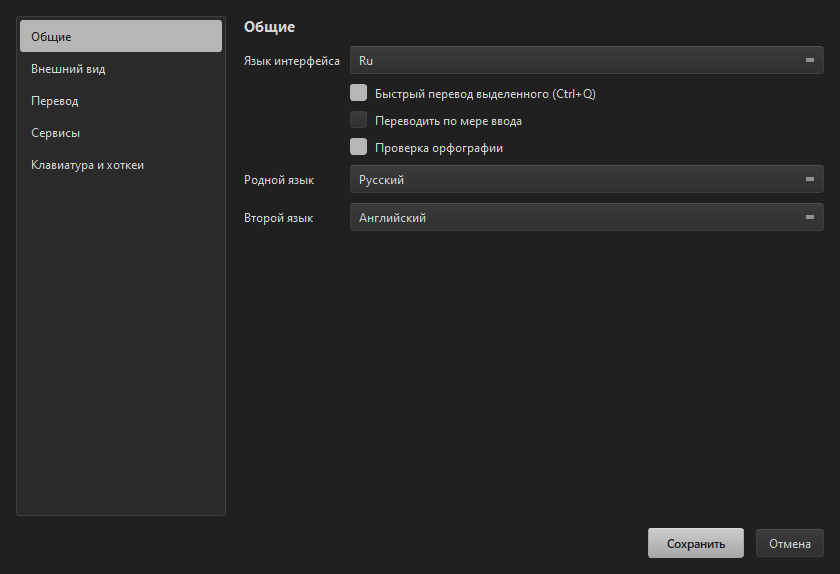
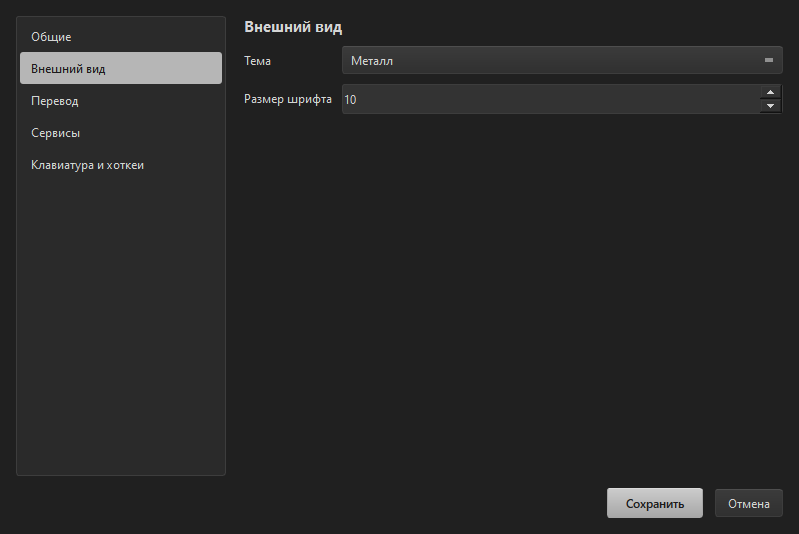
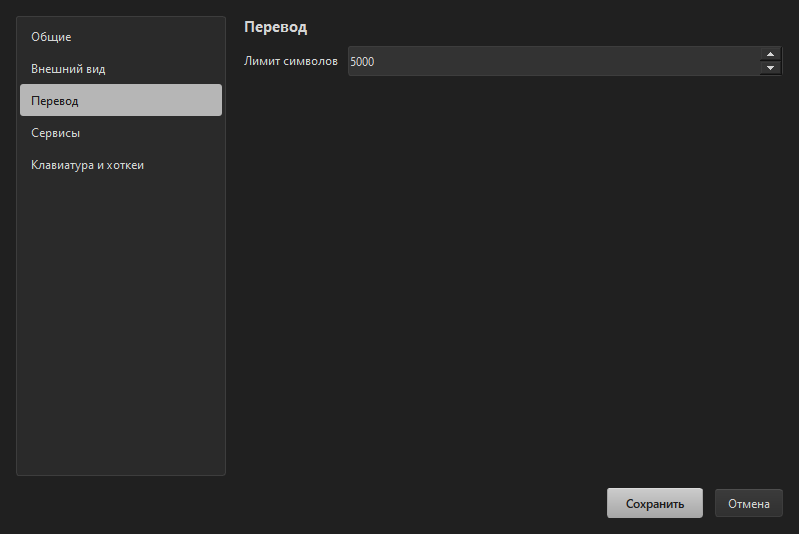
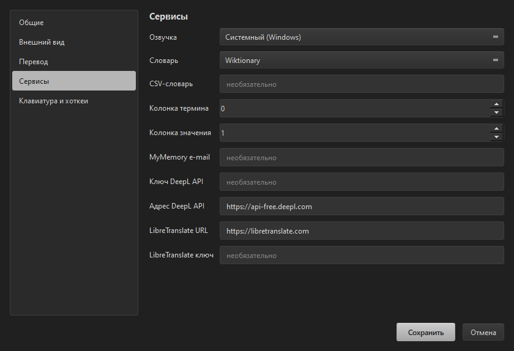
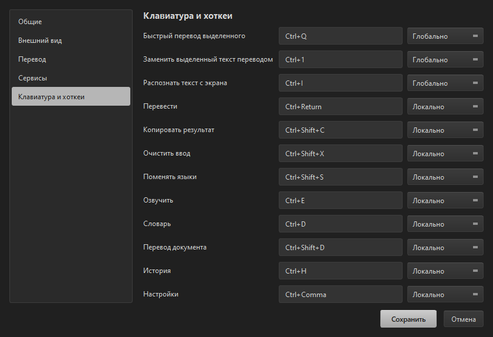
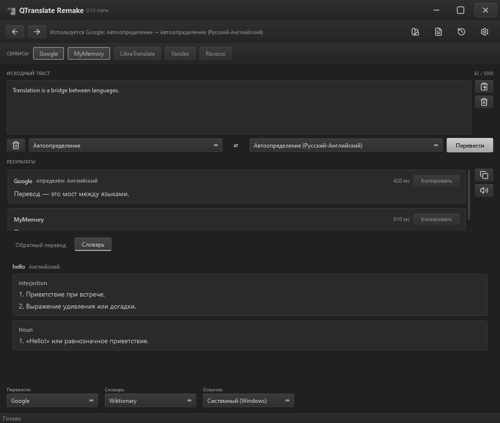

<div align="center">


# QTranslate Remake

**Переводчик в духе QTranslate 6.10 — но на Python и со своим интерфейсом.**

Выделил текст → нажал `Ctrl+Q` → понял, не переключая окно.

**Русский** · [English](README.en.md)

**Экосистема:** [QMessages](https://github.com/Awaynos/QMessages) — быстрые заготовки для переписки.


<br>


<br><sub>Главное окно: несколько переводчиков сразу, авто-пара «Русский–English», панель обратного перевода.</sub>

</div>

---

## Как это появилось

В **феврале 2026 года** я написал каркас для своего приложения — **QTranslate Remake**, аналога QTranslate 6.10.0, но на Python. Хотелось не «ещё один переводчик», а свой инструмент, который я понимаю от начала до конца.

Спустя **восемь месяцев** я решил вернуться и доделать проект: появился интерес работать во благо простых пользователей. Через ИИ сделал нормальный интерфейс — и возникла идея выложить всё это на GitHub. Так личная поделка превратилась в проект, который вы сейчас читаете.

Внутри **нет AI-функций**: ни суммаризации, ни рерайта, ни обращений к нейросетям. Только обычные переводчики, словарь, озвучка и работа с документами — так задумано.

---

## Что умеет

### Перевод

| | |
|---|---|
| **Несколько переводчиков сразу** | Google, Bing, DeepL, Yandex, Reverso, MyMemory, LibreTranslate — результат каждого отдельной карточкой |
| **Автоопределение языка** | Если сервис не умеет определять сам, ему подставляется язык, найденный другим сервисом |
| **Авто-пара «Родной–Второй»** | Пишешь по-русски — получаешь английский; пишешь по-английски — получаешь русский. Без переключений |
| **Перевод по мере ввода** | С настраиваемой задержкой |
| **Обратный перевод** | Отдельная вкладка: видно, как результат переводится назад |
| **История** | Навигация «назад/вперёд» в шапке и отдельный диалог с восстановлением |
| **Длинный текст** | Режется на части автоматически, есть лимит символов |

### Быстрые действия (глобальные горячие клавиши)

| | |
|---|---|
| **`Ctrl+Q`** | Быстрый перевод выделенного — попап у курсора, сам закрывается при клике в пустое место |
| **`Ctrl+1`** | **Замена выделенного текста переводом** — прямо в том приложении, где работаешь |
| **`Ctrl+I`** | **Распознавание текста с экрана**: выделяешь область — текст попадает в поле ввода и переводится |
| **`Ctrl+E`** | Озвучить выделенное или результат |
| **`Ctrl+D`** | Словарь по слову |
| **`Ctrl+Shift+D`** | Перевод документа |
| **Все комбинации настраиваются** | Запись комбинации и выбор области: локально или глобально |

### Сервисы

| | |
|---|---|
| **Озвучка** | Системная (Windows SAPI) и Google TTS |
| **Словарь** | Wiktionary (официальный MediaWiki API) и **свой CSV-словарь** — глоссарий, аббревиатуры, коды ошибок |
| **Без ключей** | Google, Bing, DeepL (бесплатный веб-эндпоинт), Yandex, Reverso и MyMemory работают без API-ключей. DeepL можно перевести на официальный API по ключу, LibreTranslate — на свой сервер |

### Документы

Перевод **TXT, SRT, VTT, DOCX, PDF** с прогрессом и отменой.
Субтитры сохраняют тайминги, DOCX — абзацы и таблицы, PDF отдаётся текстом.

### Интерфейс

- Своё окно без системной рамки: перетаскивание за заголовок, растягивание за любую грань, кнопки `– □ ✕` внутри приложения.
- **Четыре темы:** Металл, Бирюза, Бронза, Светлая. По умолчанию — Металл, шрифт 10.
- **Индикатор загрузки с логотипом** — кольцо у курсора и полоса в статус-баре.
- **Трей**: сворачивание уводит окно в трей, двойной клик возвращает.
- **Распознавание текста с экрана** — `Ctrl+I`: выделяешь область, системный Windows OCR возвращает текст, и он сразу уходит в перевод.
- **Проверка орфографии** — волнистое подчёркивание и подсказки по правому клику; словари берутся из Windows.
- **Локализация**: русский, английский, немецкий, французский, китайский, японский, казахский и грузинский; язык интерфейса выбирается в настройках.

### Что запоминается

Всё, что ты меняешь, сохраняется и переживает перезапуск: тема, шрифт, языки, включённые сервисы, выбранные «Перевести / Словарь / Озвучка», горячие клавиши, размеры областей, выбранная вкладка, размер и положение окна.

**Где лежат данные:** `%APPDATA%\QTranslate Remake\`
- `settings.json` — все настройки;
- `history.json` — история переводов.

Как открыть папку: нажми `Win+R`, вставь `%APPDATA%\QTranslate Remake` и нажми Enter. Удаление этой папки сбрасывает приложение к настройкам по умолчанию и очищает историю.

<div align="center">

<br><sub>Быстрый перевод по <kbd>Ctrl+Q</kbd></sub>
</div>

---

## Установка и запуск

Нужен **Python 3.11+**.

```powershell
git clone https://github.com/Awaynos/QTranslate-R.git
cd QTranslate-R

python -m venv _local\.venv
& "_local\.venv\Scripts\python.exe" -m pip install -r requirements.txt
& "_local\.venv\Scripts\python.exe" run.py
```

Готовая сборка есть: скачай `QTranslateRemake.exe` со страницы релизов — Python не нужен.

Настройки и история при запуске из исходников лежат в `_local\data`; у собранного `.exe` они
хранятся в профиле пользователя — `%APPDATA%\QTranslate Remake`.

---

## Горячие клавиши по умолчанию

| Клавиши | Действие |
|---|---|
| `Ctrl+Q` | Быстрый перевод выделенного |
| `Ctrl+1` | Заменить выделенный текст переводом |
| `Ctrl+I` | Распознать текст с экрана |
| `Ctrl+E` | Озвучить |
| `Ctrl+D` | Словарь |
| `Ctrl+Enter` | Перевести |
| `Ctrl+Shift+C` | Копировать результат |
| `Ctrl+Shift+X` | Очистить ввод |
| `Ctrl+Shift+S` | Поменять языки местами |
| `Ctrl+Shift+D` | Перевод документа |
| `Ctrl+H` | История |
| `Ctrl+Comma` | Настройки |

Всё это меняется в **Настройки → Клавиатура и хоткеи**.

---

## Настройки

Настройки — это отдельное окно с боковым меню:

- **Общие** — язык интерфейса, родной и второй язык, быстрый перевод выделенного, перевод по мере ввода, проверка орфографии
- **Внешний вид** — тема оформления, размер шрифта
- **Перевод** — лимит символов
- **Сервисы** — озвучка, словарь, CSV-файл, e-mail MyMemory, URL и ключ DeepL, URL и ключ LibreTranslate
- **Клавиатура и хоткеи** — запись комбинаций и их область: локально или глобально

<div align="center">
<table>
<tr>
<td align="center"><br><sub>Общие</sub></td>
<td align="center"><br><sub>Внешний вид</sub></td>
</tr>
<tr>
<td align="center"><br><sub>Перевод</sub></td>
<td align="center"><br><sub>Сервисы</sub></td>
</tr>
<tr>
<td align="center"><br><sub>Клавиатура и хоткеи</sub></td>
<td></td>
</tr>
</table>
</div>

---

## Словарь

<div align="center">

<br><sub>Словарь: Wiktionary или свой CSV-файл</sub>
</div>

Для своего словаря укажи путь к `.csv` и номера колонок с термином и значением. Кодировка определяется автоматически (UTF-8 или CP1251), в сеть ничего не уходит.

---

## Структура проекта

```
qtranslate_r/
  domain/       модели: языки, запрос/результат перевода, ошибки
  services/     интерфейсы сервисов, реестр, переводчики, озвучка, словарь
  core/         оркестрация перевода, история, документы, сборка сервисов
  config/       настройки и пути к данным
  platform/     интеграции Windows: глобальные хоткеи, захват выделения, OCR, орфография
  localization/ строки интерфейса (ru/en/de/fr/zh/ja/kk/ka)
  ui/           PySide6: окно, диалоги, темы, иконки, индикаторы
  quick.py      быстрый перевод по Ctrl+Q
  inline.py     замена выделенного по Ctrl+1
languages/      файлы языков интерфейса
icons/          логотип и наборы SVG-иконок
tools/          проверки и рендер скриншотов
VERSION         версия приложения (правится блокнотом)
run.py          точка входа
```

---

## Технологии

| | |
|---|---|
| Язык | Python 3.11 |
| Интерфейс | PySide6 / Qt 6 (пакет Essentials: QtCore, QtGui, QtWidgets, QtSvg) |
| Сеть | requests |
| Документы | python-docx (DOCX), pypdf (PDF) |
| OCR | Windows.Media.Ocr — системный движок, без внешних сервисов |
| Орфография | Windows Spell Checking API |
| Платформа | Windows (глобальные хоткеи, трей, ресайз окна — через Win32) |

Сервисы описаны контрактами (`Translator`, `TextToSpeech`, `Dictionary`), поэтому новый переводчик добавляется отдельным модулем, без правок ядра.

---

## Что дальше

- [x] Распознавание текста с экрана (OCR) — `Ctrl+I`
- [x] Проверка орфографии в поле ввода
- [ ] Поиск изображений по слову
- [ ] Задел под плагины: загрузка сервисов из внешних модулей
- [ ] Больше языков перевода
- [ ] Больше языков интерфейса
- [ ] Кастомные темы: создание и редактирование прямо в приложении
- [ ] Поддержка Linux и macOS

---

## ❤️ Поддержать проект

Разработка и поддержка переводчика занимает время — буду благодарен за поддержку 🫡

**Внимание:** отправляй перевод **только в указанной сети** — перевод в другой сети может быть потерян безвозвратно.

| Монета | Сеть | Адрес |
|---|---|---|
| **Bitcoin (BTC)** | Bitcoin (SegWit) | `bc1qfaylkgnwct052snamqmnxl3uk26xpt5jg344fs` |
| **Ethereum (ETH)** | ERC-20 | `0x44628629c1C6f8E8591d4f93735Ff6CD70DC8AfC` |
| **Tether (USDT)** | BEP-20 (BSC) | `0x44628629c1C6f8E8591d4f93735Ff6CD70DC8AfC` |
| **Solana (SOL / SPL)** | Solana | `3sTNRxJqATsJsKWyM5dxi4HHMLEKbp8f8dGU4wJ1xmE9` |

Поддержка полностью добровольна. Помочь можно и без денег: сообщить о баге, предложить идею, перевести интерфейс или просто поставить звезду проекту.

---

## Версия и лицензия

**0.1.0 Alpha** — активная разработка, возможны изменения.
Версия лежит в файле [`VERSION`](VERSION) и правится обычным блокнотом.

Проект распространяется под лицензией **[PolyForm Noncommercial 1.0.0](LICENSE)** ([русский перевод](LICENSE.ru.md)) — это *source-available*, а не open source.

Лицензия выбрана осознанно: **она запрещает зарабатывать на этом проекте**. Мне важно, чтобы любой мог свободно форкнуть, изучить и доработать QTranslate Remake — но чтобы никто не превращал его в платный продукт и не получал с него выгоду.

**Что можно:** пользоваться, изучать, менять, форкать — для любых некоммерческих целей, бесплатно.
**Что нельзя:** продавать, включать в платные продукты и услуги, использовать с коммерческой выгодой.

Коммерческое использование возможно **только по отдельному разрешению автора** — напиши мне, если это нужно.
